<div align="center">


<h1>macontrol</h1>

<p><strong>See where your disk space went, and get it back safely.</strong><br>
A native macOS app that maps your disk, cleans it up and removes the apps you don't want, Apple's included.<br>
Everything goes to the Trash first, unless you turn on hardcore mode.</p>

[](#install)
[](Package.swift)
[](#install)
[](LICENSE)
[](CHANGELOG.md)

**[Download](https://macontrol.vercel.app)** · [Features](#features) · [Safety](#safety) · [Docs](https://macontrol.vercel.app/docs/) · [Build from source](#build-from-source)

</div>

<br>

<picture>
  <source media="(prefers-color-scheme: dark)" srcset="docs/assets/screenshots/disk-map-sunburst-dark.png">
  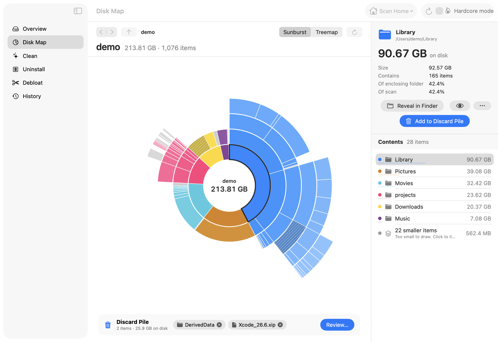
</picture>

> [!NOTE]
> **0.2.0 is a preview.** It runs on Apple Silicon Macs with macOS 14 or later and is not notarized. Whatever it removes goes to the Trash, unless you turn on hardcore mode. The administrator helper is tested only as a normal user so far: its first real run with an administrator password is still to come ([Known limits](#known-limits-in-020)).

## Why macontrol

Most disk tools either show you where the space went or offer to clean it up. macontrol does both in one window, on one scan engine and one safety layer.

- **See it.** A sunburst or a treemap of your home folder, the whole disk or any folder, sized by what each item takes up on disk.
- **Free it.** Caches, logs and developer leftovers from a vetted catalog, and apps together with the files they leave behind.
- **Debloat it.** Remove Apple's optional apps, such as Xcode, GarageBand and the iWork apps, with the content they install. Items owned by the system are removed after you enter your administrator password.
- **Trust the numbers.** Hard links count once, folders it cannot read say "not scanned" instead of 0 B, and Clean and the Disk Map tell you how much emptying the Trash will actually free before anything moves.
- **Change your mind.** By default every removal goes to the Trash and into a journal, and History puts a whole batch back in one click. Permanent deletion is there when you want it, behind hardcore mode.

## Features

### Disk Map

<picture>
  <source media="(prefers-color-scheme: dark)" srcset="docs/assets/screenshots/disk-map-treemap-dark.png">
  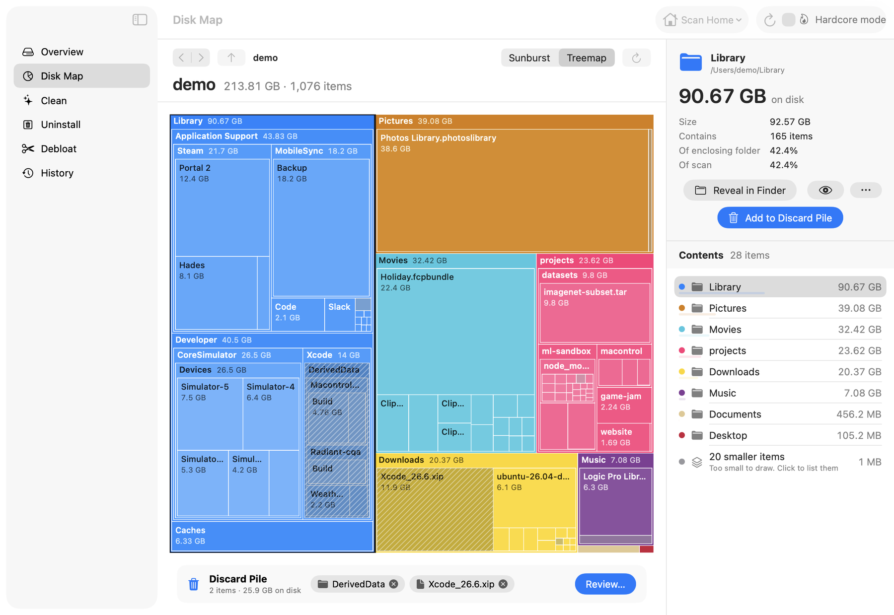
</picture>

- **Sunburst or treemap** over the same scan. Scan your home folder, the startup disk, or any folder with ⌘O.
- **Proportional to bytes.** Area and angle follow size on disk. Items too small to draw are grouped into one "N smaller items" entry that lists them, so nothing silently disappears.
- **Explore.** Drill into folders, go back and forward, follow the breadcrumb up. The inspector shows size on disk, logical size and share of the folder and of the scan, with Reveal in Finder and Quick Look.
- **Discard Pile.** Stage items (they turn hatched on the map), then review them together before anything moves.
- **Keyboard first.** Arrow keys move the selection, Return opens, Esc or ⌘↑ goes up, ⌘[ and ⌘] go back and forward, Space opens Quick Look.
- **Readable colours.** Every pair of top-level colours stays distinct under deuteranopia and protanopia, and a test keeps it that way.

<p align="center">
  <picture>
    <source media="(prefers-color-scheme: dark)" srcset="docs/assets/screenshots/disk-map-review-dark.png">
    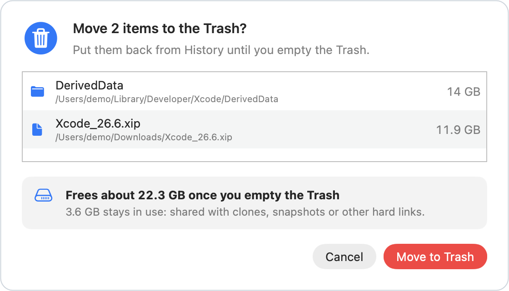
  </picture>
  <br>
  <sub>The review says what emptying the Trash will free, and what stays in use because clones, snapshots or other hard links share it.</sub>
</p>

### Clean

<picture>
  <source media="(prefers-color-scheme: dark)" srcset="docs/assets/screenshots/clean-dark.png">
  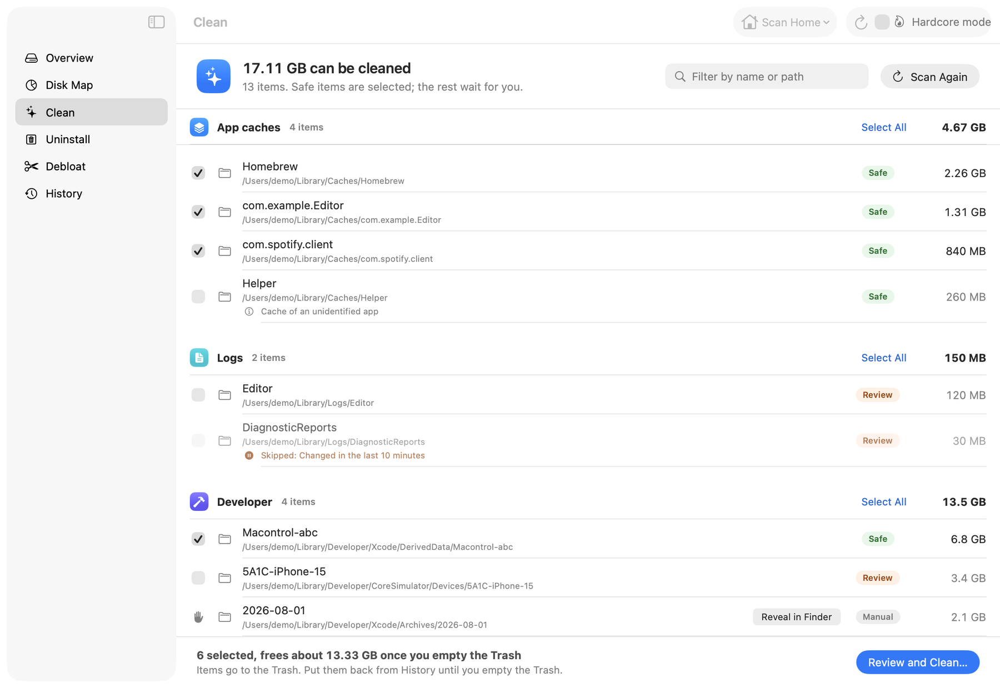
</picture>

- **A vetted catalog** of 27 rules, shipped inside the signed app: browser caches (Safari, Chrome, Firefox, Edge, Brave, Arc), Xcode build data, device support files and simulator caches, package manager caches (Homebrew, npm, Yarn, pnpm, pip, Cargo, Go, Gradle, Maven, CocoaPods, Carthage, SwiftPM), app caches and logs.
- **Safe, Review, Manual.** Only Safe items are preselected. Review items wait for you. Manual items (iPhone and iPad backups, Xcode archives, macOS installer leftovers) show their size and a Reveal in Finder button, and are never cleaned in bulk.
- **Hands off live data.** Anything changed in the last 10 minutes, or belonging to an app that is running, is skipped and the reason is shown.
- **Rules fail closed.** Every rule is checked when the catalog loads. A pattern that reaches outside the folders the catalog is meant for drops the whole rule.

### Uninstall

<picture>
  <source media="(prefers-color-scheme: dark)" srcset="docs/assets/screenshots/uninstall-dark.png">
  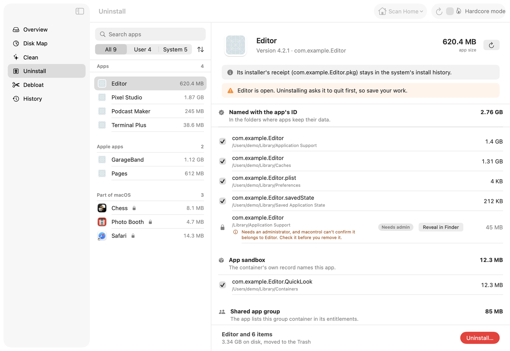
</picture>

- **Leftovers with evidence.** Files named with the app's bundle identifier in the places apps keep data (Application Support, Caches, Preferences, Saved Application State, Logs and more), sandbox containers that macOS records as the app's, group containers from its entitlements, and launchd jobs that start a program inside it. Each group says why it matched.
- **Cautious by default.** Folders that only share the app's name are shown but not preselected. Data that another installed app also uses is never preselected.
- **In the right order.** The app is asked to quit (never force-quit) and its own background agents are stopped first. Then the app and the leftovers you chose go in one batch, and no leftover moves while the app is still in place.
- **Sort and filter.** Sort by name, date added or size, and show all apps, yours or Apple's.
- **Root-owned apps and leftovers,** which usually include Apple's App Store apps, carry an "Admin" badge and are removed through the [administrator helper](#administrator-removals).
- **Apps that are part of macOS** live on the sealed system volume and are listed with the reason they can't be removed.

### Debloat

<picture>
  <source media="(prefers-color-scheme: dark)" srcset="docs/assets/screenshots/debloat-dark.png">
  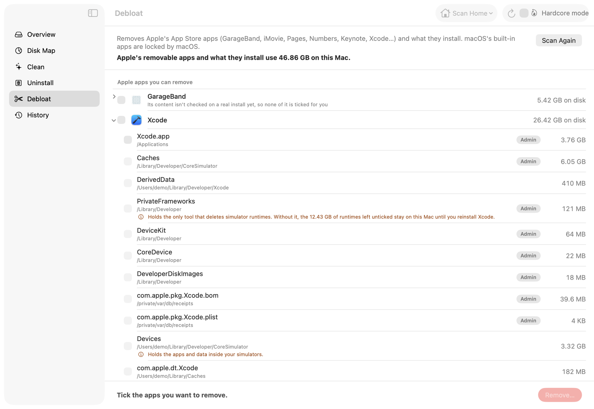
</picture>

- **Apple's optional apps in one checklist:** Xcode, GarageBand, Logic Pro, MainStage, iMovie, Pages, Numbers, Keynote, Final Cut Pro, Motion and Compressor, each with the content it installs outside its bundle (sound libraries, simulator caches, frameworks, package receipts).
- **Nothing starts ticked.** Tick an app, and the content macontrol has checked for it is ticked with it. Content that is shared with another app, holds your own work, or hasn't been checked on a real install stays unticked, with a note that says why.
- **Xcode in the right order.** Its simulator runtimes are deleted first, with Xcode's own tool, while Xcode is still there to do it. If git and clang pointed into the Xcode you remove, the confirmation warns you and gives you `sudo xcode-select --reset` to run afterwards.
- **One password for the whole run.** Everything owned by the system goes in one request to the administrator helper, so macOS shows one password dialog, however many apps you picked.

Only the Xcode profile has been checked against a real install so far. The others come from Apple's install layout and start with their content unticked until they are checked.

### Hardcore mode

<table>
  <tr>
    <td width="45%">
      <picture>
        <source media="(prefers-color-scheme: dark)" srcset="docs/assets/screenshots/hardcore-modal-dark.png">
        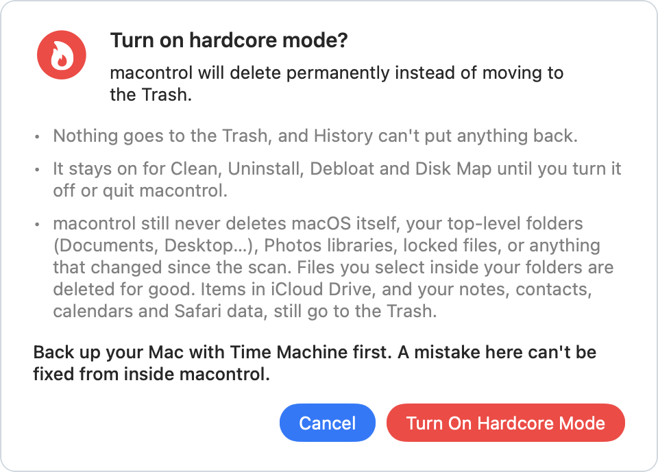
      </picture>
    </td>
    <td width="55%">
      <picture>
        <source media="(prefers-color-scheme: dark)" srcset="docs/assets/screenshots/hardcore-uninstall-dark.png">
        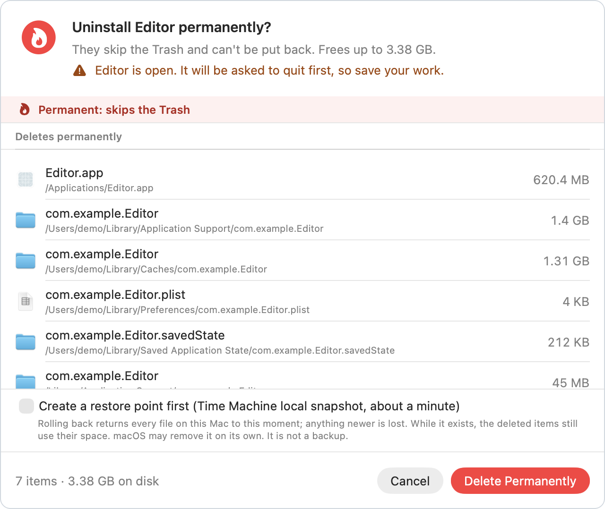
      </picture>
    </td>
  </tr>
</table>

- **A checkbox in the toolbar,** on every screen. Off, the default at every launch, removals go to the Trash. macontrol never remembers it.
- **A warning first.** Ticking it opens the warning above. Return and Esc both cancel it, and the red button has no keyboard shortcut. While it is on, a red banner says so on every screen.
- **Every removal still asks.** Each permanent confirmation is marked in red and lists what will be deleted. Return never presses "Delete Permanently".
- **Some things still go to the Trash:** anything in iCloud Drive or another cloud folder, and your notes, contacts, calendars, Safari data and iPhone backups. The confirmation lists them apart, with the reason.
- **Restore point.** A permanent confirmation can make a Time Machine local snapshot first. It is never automatic: rolling back returns every file on the Mac to that moment, and the snapshot holds on to the deleted data while it exists.
- **Folders are never left half deleted.** A folder goes to the Trash first and is erased there, so if the erase stops halfway, the rest waits in the Trash under its own name instead of in its old place.

### Administrator removals

Apple's App Store apps and many leftovers in `/Library` belong to the system, so removing them needs root. In Clean, Uninstall and Debloat these items carry an "Admin" badge. When you confirm, macOS asks for your administrator password in one dialog for the whole removal, with a message that says how many items it is for and whether they go to the Trash or are deleted.

The password starts a small helper inside the app, `Contents/Helpers/macontrol-priv`. It is not installed anywhere, and it exits when the removal is done. It reads the list you confirmed, checks each item again as root and then moves or deletes it:

- **It can only reach** app bundles in `/Applications`, items inside a few `/Library` folders (Application Support, Audio, Caches, Developer, LaunchAgents, LaunchDaemons, Logs, Preferences, PrivilegedHelperTools), package receipts, and root-owned items in your own Library.
- **It never touches** macOS's own settings in those folders, `/System`, `/private/etc`, keychains, other users' folders, locked files or anything that changed since the scan. It never changes permissions, ownership or flags to force a removal.
- **Root-owned items go to your Trash, not root's.** History can't put them back itself; drag them back in Finder, which may ask for your password.
- **The Disk Map never uses it.** Root-owned items there stay marked "Needs admin", with Reveal in Finder.

### Apps that are part of macOS

Chess, Stocks, News and the other apps that come with macOS live on a sealed, read-only system volume. macontrol shows them locked, with their size and why no app can remove them while System Integrity Protection is on. For people who want to do it anyway, an expert guide lists the steps to run in Terminal yourself and how to undo them, behind a list of risks and an "I have a backup and I accept these risks" box. It is strongly not recommended: it means turning off System Integrity Protection and FileVault, macOS updates bring the apps back, and almost no space comes back. macontrol runs none of these commands. The same text is in [docs/guides/remove-system-apps.md](docs/guides/remove-system-apps.md).

### Overview and History

<table>
  <tr>
    <td width="50%">
      <picture>
        <source media="(prefers-color-scheme: dark)" srcset="docs/assets/screenshots/overview-dark.png">
        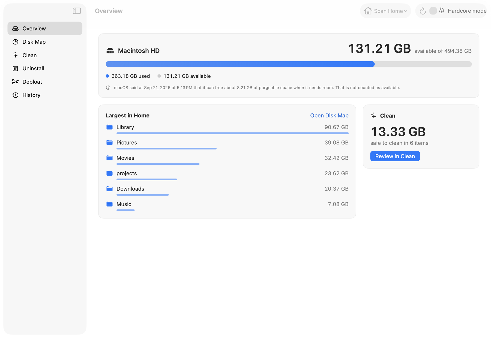
      </picture>
    </td>
    <td width="50%">
      <picture>
        <source media="(prefers-color-scheme: dark)" srcset="docs/assets/screenshots/history-dark.png">
        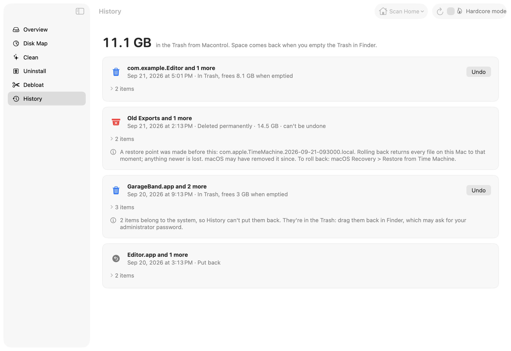
      </picture>
    </td>
  </tr>
  <tr>
    <td><strong>Overview</strong> shows capacity, the largest folders in your home and how much is safe to clean. Purgeable space appears as a dated note and is never counted as free.</td>
    <td><strong>History</strong> lists every batch macontrol removed. Batches in the Trash show what they free once you empty it and have an Undo button. Permanent deletions and restore points are listed too.</td>
  </tr>
</table>

## Performance

The scan engine walks folders in parallel with `getattrlistbulk`, opening each folder relative to its parent, so trees nested deeper than `PATH_MAX` are still measured. It backs off in Low Power Mode and when the Mac runs hot. `mcscan` is the same engine as a command-line tool, measured here against two fast scanners on a warm cache (hyperfine, 5 timed runs):

| Tree | macontrol | ncdu -t8 | dua |
|---|---|---|---|
| Fixture, 311k items | **0.68 s**, exact | 1.58 s, exact | 0.60 s, 8.4 MB short |
| `~/projects`, about 850k items | 2.10 s | 2.88 s | 1.95 s |

The fixture is built to be hard: hard links, clones, deep chains and an unreadable folder. "Exact" means the allocated total matches its ground truth to the byte. On `~/projects` all three tools agree to the byte. dua is a little faster, but it misses hard-linked data on the fixture. macontrol keeps the whole tree in memory for the map: about 75 bytes per item on the fixture.

Measured on an Apple M1 (8 cores, 8 GB, macOS 26.6) while another process kept one core busy (load average 5.5 to 8.4), so compare the tools with each other rather than with your own Mac. Method and raw data: [docs/BENCHMARKS.md](docs/BENCHMARKS.md).

## Safety

macontrol is built to be boring about your files:

- **Trash by default.** Unless hardcore mode is on, removals go through macOS's own Move to Trash, and macontrol never empties the Trash: the space comes back when you do.
- **Permanent only on purpose.** Permanent deletion needs hardcore mode, which is off at every launch and turns on only after its warning, and then the removal's own red confirmation. Items in iCloud Drive or another cloud folder, and your notes, contacts, calendars, Safari data and iPhone backups, go to the Trash even then.
- **Undo journal.** Every item moved to the Trash is recorded in `~/Library/Application Support/Macontrol/trash-journal.jsonl`, readable only by you. History puts a batch back as long as it is still in the Trash and its original place is free. Permanent deletions are recorded too, and have no Undo.
- **Checked again at the last moment.** Right before an item moves or is deleted, its identity is compared with what the scan saw. A file that was replaced, or swapped for a link, since the scan stays where it is. A permanent delete works through open folder handles, so a folder swapped for a link halfway through is never followed.
- **Protected places.** Your home folder, Desktop, Documents, Downloads, Pictures, Movies and Music, `/Applications`, `/Library`, and system folders are never removed, nor is any folder that contains them. Keychains, `~/.ssh`, `~/.gnupg`, Mail, Messages, photo libraries, privacy (TCC) data, cloud sync state and `/System` are off limits entirely, contents included. Locked files are refused, and macontrol never changes a flag or an owner to force a removal.
- **Cloud needs consent.** Items in iCloud Drive or other cloud storage folders need an extra confirmation, because removing them removes them on every device.
- **Admin powers, fenced in.** Root-owned items are removed only by the bundled helper, only after macOS's password dialog, only in the places listed under [Administrator removals](#administrator-removals), and only after the helper has run every check above again as root. The request it acts on is bound to that dialog by its SHA-256, and a result file kept from another run is not believed. The helper has no Undo: what it moved goes back through Finder.
- **One door.** Only the Safety module can move or delete files. A test fails if any other source file deletes, moves or renames files, runs a script or launches a process. The exceptions are named in the test: `launchctl` to stop an app's background jobs, Xcode's own `simctl` for simulator runtimes, `tmutil` for restore points, and the one call that starts the administrator helper.
- **Attacked on purpose.** An attack suite swaps folders for links in the middle of a batch and of a permanent erase, uses hostile file names, locked files and paths deeper than `PATH_MAX`, rewrites the helper's request after the password, and replays old helper results.

<p align="center">
  <picture>
    <source media="(prefers-color-scheme: dark)" srcset="docs/assets/screenshots/clean-results-dark.png">
    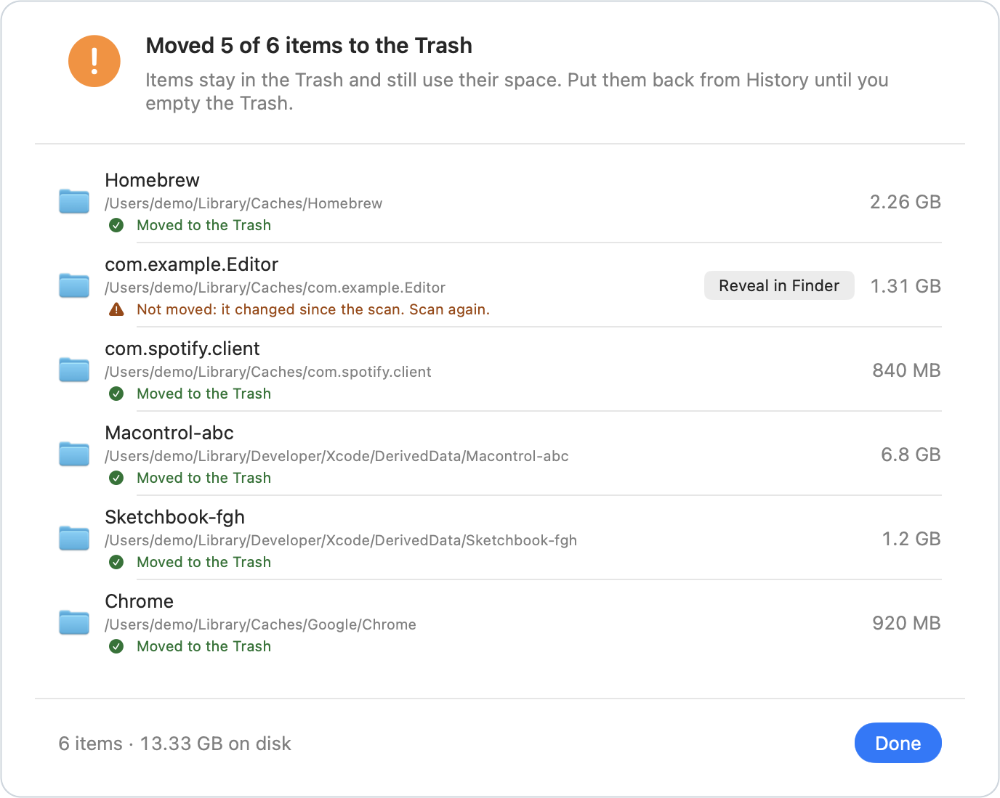
  </picture>
  <br>
  <sub>One cache changed after the scan, so it was left alone.</sub>
</p>

## Install

1. Download **Macontrol-0.2.0.zip** from [macontrol.vercel.app](https://macontrol.vercel.app) and unzip it in Finder.
2. Move **Macontrol.app** to Applications.
3. Open it. macOS blocks the first launch because the app is not notarized: open **System Settings › Privacy & Security** and click **Open Anyway**. You do this once. On macOS 14 you can also Control-click the app and choose Open.
4. Allow **Full Disk Access** when asked. macontrol walks you through it and continues by itself once access is on.

Without Full Disk Access the app still works. Mail, Messages, Safari, cookies and the Trash then show as "not scanned" instead of as smaller numbers.

From 0.2.0 on, every release is signed with the same macontrol certificate, so macOS should keep the Full Disk Access grant through updates. Coming from 0.1.x, which was signed ad hoc, you allow it once more.

<p align="center">
  <picture>
    <source media="(prefers-color-scheme: dark)" srcset="docs/assets/screenshots/full-disk-access-dark.png">
    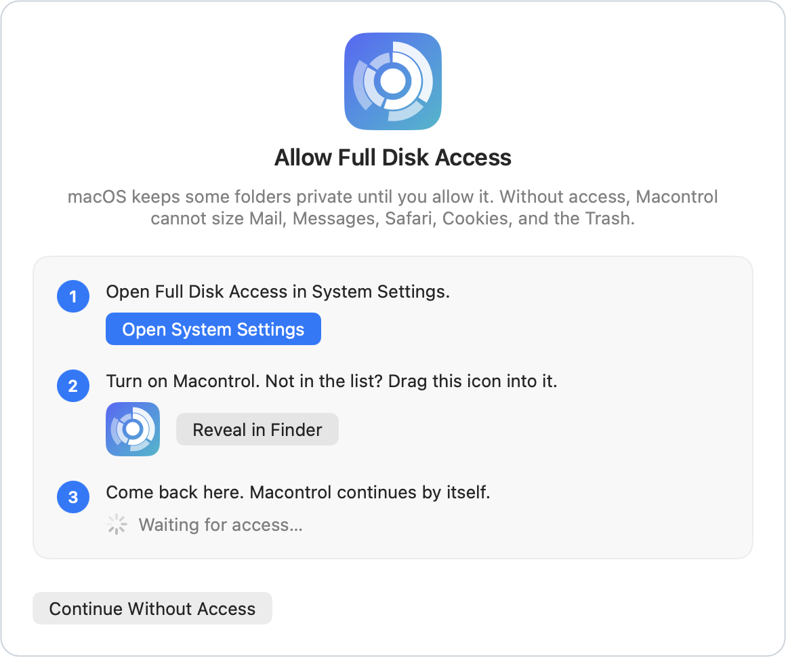
  </picture>
</p>

**Requirements:** an Apple Silicon Mac with macOS 14 Sonoma or later.

### Known limits in 0.2.0

- The administrator helper has not run as root yet. Its checks and both removal modes are tested as a normal user on temporary folders. The first real run, with an administrator password on a real Mac, is the next verification step (T-0078 on the [project board](https://macontrol.vercel.app/board/)).
- Only Debloat's Xcode profile has been checked against a real install. The other Apple app profiles start with their content unticked.
- Debloat's hardcore confirmation has no restore point box yet, and a hardcore confirmation's title also counts the items that still go to the Trash (T-0086, T-0085).
- That Full Disk Access survives an update is checked against the signature macOS stores, not yet through a real update.
- While an iOS Simulator is running, Clean skips the caches it cannot inspect.

The full list is in the [changelog](CHANGELOG.md).

## Build from source

You need Xcode 26 (Swift 6.2). There are no third-party dependencies.

```sh
git clone https://github.com/Ege-BULUT/macontrol.git
cd macontrol
swift build              # build the app and the mcscan tool
swift test               # run the tests
scripts/bundle-app.sh    # release build with the helper, signed, as build/Macontrol.app
open build/Macontrol.app
```

Full Disk Access is tied to the app's signature, and an ad hoc signature changes with every build. Run `scripts/make-signing-cert.sh` once to make a local self-signed certificate: `bundle-app.sh` then signs with it, and the grant stays across rebuilds. Without it, the script signs ad hoc. [docs/RELEASING.md](docs/RELEASING.md) has the details.

```sh
# Allocated size of a folder, in bytes, from the same engine the app uses
swift run -c release mcscan ~/Downloads

# Every screen as PNG, light and dark, with demo data
build/Macontrol.app/Contents/MacOS/Macontrol --snapshot /tmp/shots
```

How the pieces fit together, and why: [docs/ARCHITECTURE.md](docs/ARCHITECTURE.md).

## Roadmap

- [x] Hardcore mode: permanent delete, behind an explicit confirmation (0.2.0)
- [x] Admin removals through a privileged helper (0.2.0; the real root run is still to be verified)
- [x] Removing Apple's optional apps and their content libraries (0.2.0)
- [x] A stable signature, so Full Disk Access survives updates (0.2.0)
- [ ] 0.3.0: a live map that fills in while the scan runs
- [ ] Removing macOS's own apps from inside macontrol, once the expert guide's steps and their undo have been tested on macOS 14, 15 and 26
- [ ] Intel and universal builds
- [ ] Notarized builds with in-app updates

## Acknowledgements

macontrol was designed after studying two MIT-licensed apps: [PureMac](https://github.com/momenbasel/PureMac) for cleanup and [Radix](https://github.com/colinvkim/Radix) by Colin Kim for disk visualization.

Two lists are adapted with credit: the protected system and home folders come from [Homebrew](https://github.com/Homebrew/brew) (BSD-2-Clause), and the cloud-provider paths from PureMac (MIT). Both license texts are kept in [`Sources/Safety/ProtectedLocations.swift`](Sources/Safety/ProtectedLocations.swift). Scan speed is measured against [dua](https://github.com/Byron/dua-cli) and [ncdu](https://dev.yorhel.nl/ncdu).

## License

[MIT](LICENSE) © 2026 Ege BULUT
